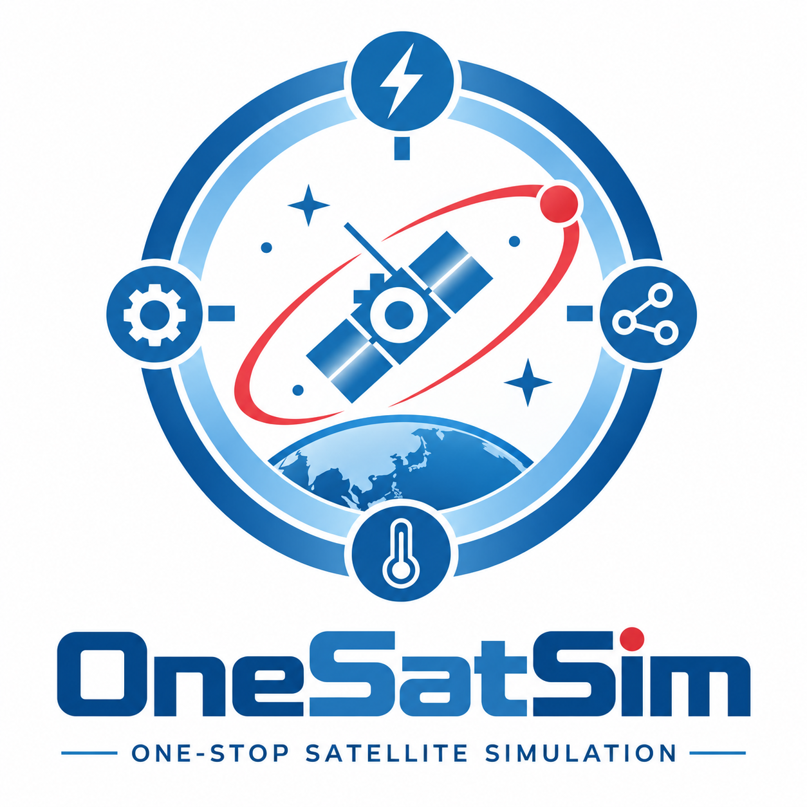
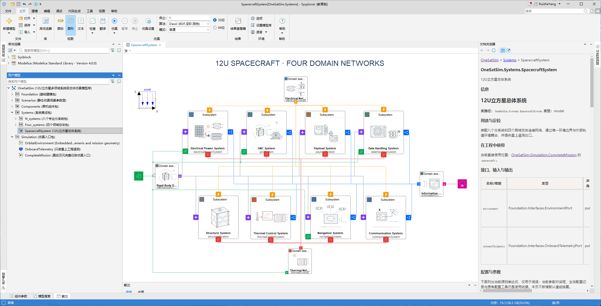

<div align="center">



# OneSatSim

### One-Stop Satellite Simulation · 一站式卫星总体仿真

**Modelica-based · Multi-physics · Mission-driven · Configurable · MOSAIC-oriented**  
**基于 Modelica · 多物理场耦合 · 任务驱动 · 参数化配置 · 遵循 MOSAIC 建模规范**

[](https://modelica.org/)
[](./package.mo)
[](https://github.com/Ruizhe-Yang/MOSAIC)
[](./doc/OneSatSim_12UCubeSat_CaseStudy.html)

[中文介绍](#中文介绍) · [English Overview](#english-overview) · [MOSAIC 规范](https://github.com/Ruizhe-Yang/MOSAIC) · [12U 案例文档](./doc/OneSatSim_12UCubeSat_CaseStudy.html)

</div>

---

<a id="中文介绍"></a>

## 1. 项目简介

**OneSatSim（One-Stop Satellite Simulation）** 是一个面向卫星总体设计的 **Modelica 系统级多物理场建模与任务仿真项目**。它将轨道环境、整星结构、姿态控制、电源、热控、载荷、数管、通信和任务规划组织在**同一套可执行模型和任务时间轴**中，用于分析复杂任务执行过程中各分系统的状态、交互与资源约束。

当前公开工程以**12U 对地观测立方星**为案例，模型根包为 `OneSatSim`，完整任务入口为 `OneSatSim.Simulation.CompleteMission`，依赖 **Modelica Standard Library（MSL）4.0.0**。根包声明的当前源码版本为 **v1.1.6**。

本项目**基于 [MOSAIC（Modelica-Oriented System Architecture, Interfaces and Contracts）建模规范](https://github.com/Ruizhe-Yang/MOSAIC) 实现**，将其系统分层、白箱/行为职责、接口契约、配置管理和图形可视化原则应用于实际卫星总体模型。

<div align="center">



<sub>OneSatSim 总体模型：四大物理／信息网络与八个卫星分系统</sub>

</div>

### 1.1 1 + 4 + 8 系统级架构

| 层次 | 组成 | 对应模型 |
|---|---|---|
| **1 个完整任务入口** | 轨道环境、整星总体、工程遥测 | `Simulation.CompleteMission` |
| **4 个总体网络** | 机械、电气、热、信息 | `Systems.Four_systems` |
| **8 个卫星分系统** | 电源、姿轨控、载荷、数管、通信、导航、热控、结构 | `Systems.N_systems` |

四大总体网络将多个设备和分系统的机械、电气、热与信息交互关联起来；八个分系统进一步装配可独立理解、配置和替换的设备模型。实际的任务控制、状态更新和物理行为由内部对应组件承担。

### 1.2 从任务到资源的联合分析

OneSatSim 的总体仿真围绕同一条时间轴开展，支持研究：

- **轨道与环境：** 真实 UTC 历元、轨道运动、日照与地影、地面站和成像目标的几何机会；
- **姿态与执行：** 姿态估计、控制模式、飞轮和磁力矩器、机动与指向误差；
- **能源与热：** 太阳阵、配电、电池 SOC、多路电压／功率、设备热耗散与温度；
- **载荷与信息：** 成像请求、设备开关、图像存储、数管与数传资源；
- **任务与安全：** 机会判断、请求与执行反馈、任务模式、保护逻辑及安全模式；
- **工程观测：** 从只读遥测出口查看电源、姿态、温度、导航、任务、存储和通信等关键状态。

这些功能服务于总体级方案论证、任务—资源权衡、模型扩展、系统工程研究及教学。具体精度与验证结论以实际模型、参数和运行证据为准。

## 2. 基于 MOSAIC 规范的工程实现

<div align="center">


</div>

**MOSAIC** 为系统级 Modelica 工程提供架构、接口、行为、配置和维护方面的统一建模约定。OneSatSim 是这一规范在**卫星总体与多物理场耦合仿真**中的具体应用案例。

| MOSAIC 建模要求 | OneSatSim 的对应实现 |
|---|---|
| 明确总体仿真边界（TB） | `Simulation.CompleteMission` 作为统一仿真入口 |
| 分系统与装配职责（SB/AB） | `Systems.SpacecraftSystem`、四大总体网络、八个分系统与内部组件装配 |
| 行为与复用单元（BU/LU） | `Components/`、`Foundation/Models/` 内的设备行为及 MSL 组件 |
| 多物理场接口与连接契约 | `Foundation/Interfaces/`、MSL 接口、真实 `connect` 关系 |
| 配置来源与一致性 | `DesignConfig.xlsx` → 离线校验／生成 → `Scenarios/Generated*.mo` |
| 结构与工作视图 | 原生 Modelica `Icon`、`Diagram`、`Placement` 与可导航实例 |
| 验证与变更可追溯 | `Scripts/Contracts/`、静态检查、运行脚本、配置与运行清单 |

其中 **TB / SB / AB 是白箱职责，BU / LU 承担具体行为或库模型复用**；角色是建模概念，不要求在 Modelica 类名前增加固定前缀。模型按照实际卫星对象命名。

**了解 MOSAIC：** [MOSAIC 规范仓库](https://github.com/Ruizhe-Yang/MOSAIC) · [MOSAIC v0.8 中文完整规范](https://github.com/Ruizhe-Yang/MOSAIC/blob/main/MOSAIC_v0.8_Modelica_Modeling_Standard.html) · [MOSAIC-skill：AI 辅助执行规范](https://github.com/Ruizhe-Yang/modelica-system-level-simulation-skill)

OneSatSim 不需要导入额外的“MOSAIC 运行库”；MOSAIC 是工程建模规范，**MOSAIC-skill** 是可选的 AI 辅助建模与检查工具。

## 3. 当前模型如何组成与运行？

### 3.1 完整任务入口

```modelica
OneSatSim.Simulation.CompleteMission
```

当前 `CompleteMission.mo` 在顶层组织三个对象：

```text
CompleteMission
├── orbitalEnvironment  : OrbitalEnvironment  # 轨道环境和任务几何
├── spacecraft          : SpacecraftSystem    # 12U 整星与多领域耦合
└── onboardTelemetry    : OnboardTelemetry    # 只读工程遥测
```

`orbitalEnvironment` 向整星传递环境与几何条件；`spacecraft` 执行系统级物理和任务行为；`onboardTelemetry` 汇集只读工程数据。顶层通过真实端口连接形成统一的仿真入口。

### 3.2 关键结果变量

可从 `onboardTelemetry` 实例中查找以下代表性变量（实际保存范围以仿真设置及结果合同为准）：

| 领域 | 示例变量 | 含义 |
|---|---|---|
| 电源 | `batterySOC`, `busVoltage[3]`, `solarNetPower` | 荷电状态、三路电压、太阳阵交付功率 |
| 热 | `batteryCellTemperature`, `obcCpuTemperature` | 电池和星载计算机温度 |
| 姿态 | `attitudeQuaternion[4]`, `wheelSpeed[4]`, `attitudeError` | 姿态、飞轮状态与指向误差 |
| 导航 | `gnssPosition[3]`, `gnssVelocity[3]` | 导航位置与速度 |
| 任务 | `missionMode`, `completedImagingCount`, `completedDownlinkCount` | 任务模式、成像与下传完成计数 |
| 数据 | `storedBytes`, `actualReadRate` | 存储占用与真实读取／下传速率 |

原始结果还包含必要的组件内部状态及事件信号。任务是否完成，应结合调度记录、数据守恒、任务验收条件等证据判断，不能只凭个别数值曲线。

## 4. 参数配置：先生成，再仿真

项目根目录的 **`DesignConfig.xlsx`** 是主要工程配置入口，可管理轨道、任务、设备及系统参数；固定星历资源随源码放在 `Scripts/Inputs/Ephemeris/`。

```text
DesignConfig.xlsx + Scripts/Inputs/Ephemeris/
                      │
                      ▼
                UpdateConfig.bat
                      │
                      ▼
        Scripts/update_transaction.py
           ├── 参数、单位和契约校验
           ├── 质量属性与星历环境计算
           └── 分阶段生成、校验和失败回退
                      │
                      ▼
    Scenarios/GeneratedScenario.mo
    Scenarios/GeneratedSpacecraftDesignConfig.mo
    Scenarios/GeneratedMassProperties.mo
    Scenarios/GeneratedEnvironmentData.mo
    Scripts/ConfigSupport/（配置快照与运行参数）
                      │
                      ▼
    OneSatSim.Simulation.CompleteMission
                  （Modelica 仿真）
```

**配置生成与 Modelica 数值仿真相分离。** 星历、场景、质量属性和硬件参数在准备阶段转换或固化到 `.mo` 文件。读取已经生成的工程进行 Modelica 仿真时，**不需要在求解过程中调用 Excel、Python 或外部星历数据文件**。

当前代码随附固定的 JPL DE440s、IERS 地球定向参数和闰秒资源，其来源见 [`Scripts/Inputs/Ephemeris/SOURCE_MANIFEST.md`](./Scripts/Inputs/Ephemeris/SOURCE_MANIFEST.md)。更换任务历元或相关资源后，需重新生成并检查有效性。

## 5. 快速开始

### 5.1 获取工程

```bash
git clone https://github.com/Ruizhe-Yang/OneSatSim.git
cd OneSatSim
```

工程顶层目录应直接包含 `package.mo`、`DesignConfig.xlsx` 和 `Scripts/`，根 Modelica 包名是 `OneSatSim`。

### 5.2 环境依赖

- **Modelica：** MSL **4.0.0**；推荐使用 [OpenModelica](https://openmodelica.org/) / OMEdit 打开和检查。也可在 [MWORKS.Sysplorer](https://www.tongyuan.cc/) 中导入，但需核对当前版本的实际兼容性。
- **Python：** 配置与运行脚本使用 Python；由于仓库当前锁定了较早的 NumPy / SciPy / Astropy 版本，建议优先使用 **Python 3.10 独立环境**安装对应依赖。
- **运行工具：** 自动化执行入口使用 OpenModelica CLI（`omc`）；需要可执行的编译工具链。使用 MWORKS 手动导入时请先确认使用 **MSL 4.0.0**。

安装配置／星历生成和仿真运行脚本所需依赖：

```bash
python -m pip install -r Scripts/requirements-ephemeris.txt -r Scripts/requirements-runner.txt
```

### 5.3 直接加载现有模型

仓库已经包含生成好的场景、整星配置和环境数据。**只想浏览模型或基于当前参数尝试仿真，不必先重新生成 Excel 配置。**

在 OMEdit 中打开根目录的 `package.mo`，选择：

```text
OneSatSim → Simulation → CompleteMission
```

然后执行 **Check Model**，确认加载与方程检查情况，再进行实际编译和仿真。

也可以使用项目提供的 OpenModelica CLI 加载检查：

```bash
python Scripts/load_package.py
```

若无法找到 `omc`，可先将其加入 `PATH`，或使用 `--omc` 指定 OpenModelica 可执行文件位置。

### 5.4 修改配置（Windows）

1. 编辑并保存根目录的 `DesignConfig.xlsx`。
2. 运行 `UpdateConfig.bat`，由 `Scripts/update_transaction.py` 执行离线配置生成与发布。
3. 检查生成清单、错误信息和变更内容；重新加载更新后的 `package.mo`。
4. 对修改后的工程重新进行模型检查、编译及仿真。

配置工作流会更新多个**已跟踪的生成文件**。如在 Git 工作区中操作，建议先保留基线并查看生成前后的差异。

### 5.5 运行任务与结果验收（Windows / OpenModelica CLI）

`RunSimulation.bat` 调用项目的检查及运行脚本。可选择短时诊断或完整名义任务：

```bat
REM 带明确原因的短时检查（示例：600 秒）
RunSimulation.bat --run-kind SMOKE --stop 600 --reason first-check

REM 完整名义任务（无时间缩短或网格覆盖）
RunSimulation.bat --run-kind NOMINAL_FULL
```

运行脚本需要可访问的 `omc`；如有必要，可设置环境变量 `OMC_EXE` 为其完整路径。脚本可能在项目**父目录**下创建 `work/MOSAIC-12UCubeSat/`、`results/MOSAIC-12UCubeSat/` 等工作与结果目录。**短时诊断结果不能作为 24 小时完整任务的验收结论。**

当前生成配置的名义任务设置：

| 参数 | 配置值 |
|---|---|
| 任务历元 | 2026-10-01 00:00 UTC 至 2026-10-02 00:00 UTC |
| 仿真时间 | 0–86,400 s（24 h） |
| 输出间隔 | 1 s |
| 容差 | `1e-7` |
| 求解器 | IDA（生成配置中为 `ida`） |
| IDA 线性求解器 | `spgmr` |

这些值对应**仓库随附的当前生成配置**；修改设计表并重新生成后，以实际生效参数和运行证据为准。

## 6. 项目目录

```text
OneSatSim/
├── package.mo                  # Modelica 根包（v1.1.6，依赖 MSL 4.0.0）
├── package.order
├── DesignConfig.xlsx           # 主要设计与任务配置入口
├── UpdateConfig.bat            # 离线配置更新
├── RunSimulation.bat           # OpenModelica CLI 运行／验收
├── MOSAIC-12UCubeSat.png       # 项目标识
│
├── Simulation/
│   ├── CompleteMission.mo      # 唯一完整任务入口
│   ├── OrbitalEnvironment.mo   # 环境与轨道几何
│   └── OnboardTelemetry.mo     # 只读工程遥测
│
├── Systems/
│   ├── SpacecraftSystem.mo     # 整星集成
│   ├── Four_systems/           # 机械、电气、热、信息总体网络
│   └── N_systems/              # 八个卫星分系统
│
├── Components/                 # 电源、姿控、载荷、通信等设备单元
├── Foundation/
│   ├── Interfaces/             # 多物理场与任务信息接口
│   ├── Models/                 # 行为、控制、机会、状态与安全模型
│   ├── Calculations/           # 计算单元
│   ├── Functions/              # 辅助函数
│   ├── SignalRouting/          # 信号路由
│   └── Types/                  # 状态、类型及工程记录
│
├── Scenarios/
│   ├── DesignConfigRecords/    # 设备／分系统设计参数记录
│   ├── GeneratedScenario.mo    # 已生成的任务场景
│   ├── GeneratedSpacecraftDesignConfig.mo
│   ├── GeneratedMassProperties.mo
│   └── GeneratedEnvironmentData.mo
│
├── Scripts/
│   ├── Inputs/Ephemeris/       # 固定星历、EOP 和闰秒输入资源
│   ├── ConfigSupport/          # 已生成配置快照与清单
│   ├── Contracts/              # 参数、图形与结果合同
│   ├── DocumentationSupport/   # 文档／连线颜色辅助检查记录
│   ├── update_transaction.py
│   ├── update_config.py
│   ├── load_package.py
│   ├── run_acceptance.py
│   └── run_openmodelica.py
│
├── Figures/                    # 总体架构与项目图片
└── doc/
    └── OneSatSim_12UCubeSat_CaseStudy.html
```

注意：当前仓库已经**不再使用旧 README 中的 `tools/`、`Resources/`、`outputs/` 根目录结构**；脚本、星历输入和辅助检查记录统一存放于 `Scripts/`，运行后产生的工作目录和结果通常位于仓库父目录。

## 7. 当前版本与验证状态

| 项目 | 现状 |
|---|---|
| Modelica 源码发布版本 | **v1.1.6**（`package.mo`） |
| 对应方法规范 | **MOSAIC v0.8** |
| 仿真入口 | `OneSatSim.Simulation.CompleteMission` |
| 配置与数据链 | 已提供离线配置生成、快照和随仓库发布的 `.mo` 数据 |
| 最近辅助修订 | v1.1.6 基于 v1.1.5，主要涉及 Documentation 与实际连线颜色 |
| v1.1.6 本轮编译／仿真／GUI 核验 | **NOT_RUN / NOT_RUN / NOT_CHECKED**（见仓库发布记录） |
| 历史任务验收 | 保留此前记录，仍有 **PARTIAL** 的任务目标待闭合 |

v1.1.6 的源级辅助维护记录位于 [`Scripts/DocumentationSupport/DOC_PATCH_REPORT.md`](./Scripts/DocumentationSupport/DOC_PATCH_REPORT.md)，发布范围见 [`release_metadata.json`](./Scripts/DocumentationSupport/release_metadata.json)。现有部分自动运行和结果合同中仍保留 **v1.1.4** 的历史版本标识，**不能将这些标识或历史结果直接解释为 v1.1.6 已完成的新一轮仿真验收**。每次新运行都应单独检查实际加载、求解、输出、任务目标与验证记录。

## 8. 二次开发与研究应用

OneSatSim 可以作为新的卫星总体方案、任务算法与安全研究的基础：

- 在 `DesignConfig.xlsx` 中更改轨道、卫星设计、任务和设备参数，开展配置对比；
- 在 `Components/` 中替换或细化设备模型，通过既有接口接入分系统；
- 在 `Foundation/Models/` 扩展任务规划、控制策略、故障处理与安全模式；
- 对电源、热控、姿态、载荷或通信的局部物理建模提高保真度；
- 在得到实际运行证据后，开展任务可行性、资源裕度、控制效果和故障场景分析。

建议沿用 **MOSAIC 的明确职责、接口语义、配置来源和变更边界**。需要对既有模型进行安全分析或其他多方法分析时，可在已认可的模型基线上开展独立扩展，不必复制另一套无关的整星模型。

## 9. 方法参考、案例文档与致谢

**工程与方法参考：**

- 彭坤、王岩、李智、翁昉倞、贾雨棽，《考虑机电热信耦合的航天器系统级分布式仿真方法研究》，《宇航学报》，2025，46(9)：1896–1905。论文的“1 + 4 + N”结构、设备级多领域表达与总体耦合思想为本项目提供参考。[DOI](https://doi.org/10.3873/j.issn.1000-1328.2025.09.016)。
- 哈尔滨工业大学紫丁香学生微纳卫星团队的 [ASRTU-1 开源星务软件](https://gitee.com/openlilacsat/ASRTU-1_OBC_Software)，为任务逻辑、设备状态和星务信息组织提供工程参考。
- [MOSAIC 总体建模规范](https://github.com/Ruizhe-Yang/MOSAIC)，为当前工程的模型角色、接口与契约、配置和图形组织提供规范依据。
- Modelica Association、JPL、IERS 以及相关科学数据与开源工具的维护者。

特别感谢**大连理工大学智连星宇学社**及参与相关建模、交流和测试的老师、同学与开源社区成员。

**详细案例文档：** [OneSatSim 12U CubeSat Case Study](./doc/OneSatSim_12UCubeSat_CaseStudy.html)。案例文档反映其编写时的模型与分析内容；使用当前源码时，以相应模型、配置和最新实际验收记录为准。

**适用边界：** 本项目主要服务于系统级研究和工程原理验证；不能直接替代飞行软件、器件鉴定、结构有限元、CFD、射频电路级设计、整星环境试验或型号认证。

欢迎通过 [GitHub Issues](https://github.com/Ruizhe-Yang/OneSatSim/issues) 和 Pull Requests 反馈模型问题、交流工程案例并参与扩展。

---

<a id="english-overview"></a>

## English Overview

**OneSatSim (One-Stop Satellite Simulation)** is a **Modelica-based system-level spacecraft modeling and multi-physics simulation project**. Its public case is a **12U Earth-observation CubeSat**, bringing orbit and environment, spacecraft architecture, control and mission logic, electrical power, thermal behavior, payload, onboard data handling, communications, and resource constraints into one executable mission model.

**The project is implemented following the [MOSAIC modeling specification](https://github.com/Ruizhe-Yang/MOSAIC)** — *Modelica-Oriented System Architecture, Interfaces and Contracts*. MOSAIC provides the engineering conventions for system structure, model responsibilities, interfaces, configuration, diagrams, and evidence management. The optional [MOSAIC-skill](https://github.com/Ruizhe-Yang/modelica-system-level-simulation-skill) assists AI coding agents in applying these conventions.

### Architecture and main entry

OneSatSim uses a **1 + 4 + 8** organization: one complete mission entry, four integrated mechanical/electrical/thermal/information networks, and eight spacecraft subsystems. The actual top-level model is:

```modelica
OneSatSim.Simulation.CompleteMission
```

It contains three connected objects: **OrbitalEnvironment**, **SpacecraftSystem**, and **OnboardTelemetry**. The telemetry view provides readable outputs such as battery SOC, bus voltages, component temperatures, attitude and wheel states, GNSS data, mission modes, imaging and downlink counters, and data-storage information.

### Getting started

1. Clone the repository and open its root `package.mo` in a Modelica tool with **MSL 4.0.0**.
2. For the packaged default configuration, load `OneSatSim.Simulation.CompleteMission` and check the model before simulation.
3. To change a design or mission parameter, edit `DesignConfig.xlsx` and run `UpdateConfig.bat` on Windows. This stages and generates `Scenarios/Generated*.mo` files, including an embedded environment table.
4. To use the supplied OpenModelica CLI workflow, install the Python requirements from `Scripts/requirements-ephemeris.txt` and `Scripts/requirements-runner.txt`, then run `RunSimulation.bat`. The script supports a reason-labelled short diagnostic or a formal full-mission run.

The nominal packaged setup covers **2026-10-01 00:00 UTC to 2026-10-02 00:00 UTC**, with a 1-second output interval and `1e-7` tolerance. Configuration preparation uses fixed ephemeris/EOP/leap-second resources; the resulting Modelica simulation does **not** read the original Excel workbook or ephemeris files at integration time.

### Version and verification notice

The current root Modelica package declares **v1.1.6**, based on **MOSAIC v0.8**. The v1.1.6 maintenance release primarily updates documentation and connection-line presentation, with source-level protected-difference checks. Its published record marks **compilation NOT_RUN, simulation NOT_RUN, and GUI NOT_CHECKED for that specific maintenance revision**. Some runner and result-contract metadata still refer to historical v1.1.4 evidence; these are not equivalent to a new v1.1.6 acceptance run.

OneSatSim is intended for spacecraft systems engineering, mission/resource trade studies, education, research, and model extension. It is not a flight-qualified implementation or a replacement for detailed discipline-specific verification.

**Links:** [MOSAIC specification](https://github.com/Ruizhe-Yang/MOSAIC) · [MOSAIC-skill](https://github.com/Ruizhe-Yang/modelica-system-level-simulation-skill) · [12U CubeSat case study](./doc/OneSatSim_12UCubeSat_CaseStudy.html)

---

<div align="center">

**OneSatSim — Put the satellite mission, physics, onboard logic, and resources on one timeline.**

**OneSatSim —— 把卫星任务、物理状态、星务逻辑和资源约束放在同一条时间轴上。**

*Model the Whole as MOSAIC.*

</div>
